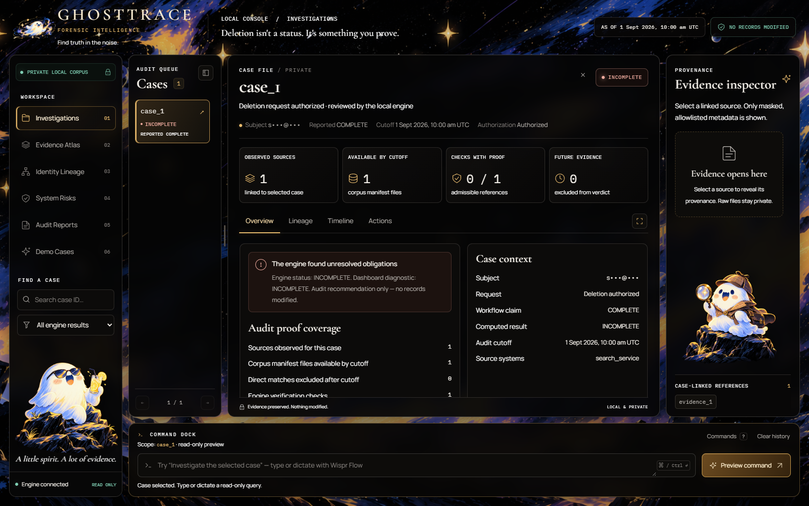

# GhostTrace

**Deletion isn't a status. It's something you prove.**

GhostTrace helps privacy engineers and audit reviewers investigate a reported data deletion. It connects current and historical identifiers to surviving records, checks the evidence against policy and an audit cutoff, and produces findings, ordered recommendations and verification checks.

**Status:** working local investigation prototype with an offline Python CLI and browser dashboard. Read-only: it recommends actions; it never deletes records or certifies compliance. No API key is required. There is no hosted demo or live model integration in this checkout.

[See the product](#the-product) · [Reviewer walkthrough](docs/REVIEWER_GUIDE.md) · [Run locally](docs/SETUP.md) · [Architecture](docs/ARCHITECTURE.md) · [Evidence & reports](docs/EVIDENCE.md)

## The product



*Actual application, captured locally on an existing project-authored synthetic historical-alias fixture. This is a working screen, not a mockup or a participant-dataset screenshot. [Screenshot provenance](docs/media/README.md).*

**Start here:** [follow one investigation](docs/REVIEWER_GUIDE.md). To see how it was built, watch the [Wispr Flow voice-driven development recording](https://youtu.be/rw3gSNBh9HQ). That video documents development; it is not a hosted product demo or evidence of a model API integration.

## Why it exists

A deletion workflow can say **COMPLETE** while a search index, analytics profile, replica or restore path still holds or recreates personal data. Old identifiers can hide those copies. Some records must instead be retained, redacted or anonymized under the supplied policy.

GhostTrace checks the underlying evidence rather than accepting the workflow's claim:

1. **Resolve the subject.** Check deletion intent and reconstruct current and historical identifiers.
2. **Follow the evidence.** Find attributable records and respect both event time and capture time at the audit cutoff.
3. **Apply the policy.** Distinguish deletion, redaction, anonymization, retention and recreation risks.
4. **Review the result.** Inspect cited findings, ordered recommendations and future verification checks. Export a sanitized report or the challenge CSV.

The same auditor powers the CLI and dashboard. The browser shows masked, case-scoped metadata; it does not make a second set of deletion decisions.

## Run locally

Requires **Python 3.10+** and the separately supplied participant-facing `dataset/`. This public repository does not redistribute the challenge corpus. The full-evidence run was recorded on Windows; OCR parity on other platforms is unverified.

```sh
python code/dashboard/serve.py
```

Open the loopback address printed by the launcher. It chooses an available port. There is no Node build, hosted backend or provider key to configure.

**No dataset yet?** The authored scenario and regression checks can run without it. See [setup, corpus requirements and safe output paths](docs/SETUP.md).

## What the evidence supports

These are **recorded results from the 25 October 2026 submission checkpoint**, not new benchmark measurements from this documentation pass.

| Measurement | Recorded result | Scope |
| --- | --- | --- |
| Output contract | 518 rows; 0 strict errors | Local structural validation, not hidden-label accuracy |
| Public status agreement | 29/32 (90.62%) | Public development requests |
| Exact ordered sequences | 8/32 (25.00%) | Same 32 requests; stronger criterion than status |
| Step F1 | 62.15% | 161 predicted / 193 reference steps |
| Positional field agreement | 945/1365 (69.23%) | Fields compared at matching array positions |

Sources: [evaluation report](code/evaluation/evaluation_report.md), [runtime and output provenance](code/evaluation/usage_report.md). Hidden-case accuracy is unknown. The local validator shares parsing logic with the solver; it is not an independent correctness oracle. The authored scenarios were reused during development.

The submission closed structural gaps while raw public step/field agreement decreased from the earlier research checkpoint. [Both results and the tradeoff are retained](code/evaluation/submission_changes.md). See the [evidence guide](docs/EVIDENCE.md) for separate software-check populations, timing scope and historical study limits.

## Capabilities and boundaries

| Available in this checkout | Boundary |
| --- | --- |
| Identity history, cutoff-aware evidence parsing and policy checks | Parser coverage and independent real-world validation remain limited |
| Case search, filters, timeline, relationship graph/table and resizable panels | Relationships come from engine links; this is not a causal recreation model |
| Masked evidence inspector and sanitized Markdown export | Allowlisted metadata only; no raw document or image previews |
| Typed or Wispr-dictated read-only commands and engine replay | Controlled command grammar, not an open-ended model agent |
| Offline CLI and local HTTP API | No hosted service, production connectors or executed remediation |

**Planned, not implemented here:** the Nebius/NVIDIA model-driven investigation extension, autonomous tool loop and public hosted demo. A separate synthetic demo gallery, streaming progress/cancellation and full redacted excerpts are also absent. The documentation screenshots use a temporary test fixture; they do not imply a built-in demo mode.

## Find your next step

| You want to… | Go to |
| --- | --- |
| Assess one concrete investigation | [Reviewer guide](docs/REVIEWER_GUIDE.md) |
| Run the dashboard, CLI or checks | [Setup guide](docs/SETUP.md) |
| Understand the engine and read-only boundary | [Architecture and limitations](docs/ARCHITECTURE.md) |
| Check measurements, sources and deliverables | [Evidence and reports](docs/EVIDENCE.md) |
| Reproduce a benchmark with a new run tag | [Benchmark methods](BENCHMARKS.md) |
| Inspect API routes and schemas | [API contract](code/dashboard/API_CONTRACT.md) · [OpenAPI](code/dashboard/web/openapi.json) |
| Read the original challenge specification | [Problem statement](problem_statement.md) |

## Provenance

Built for HackerRank Orchestrate's **Ghost Data Still Exists** challenge, with its participant-facing problem and policy. Wispr Flow was used to dictate development instructions to an AI coding assistant; it is not an embedded SDK or an endorsement. The submitted program makes zero model API calls; development-assistant usage is separate.

The ghost artwork belongs to the existing Noir interface. Cormorant Garamond, Manrope and IBM Plex Mono are self-hosted with their [bundled OFL notices](public/assets/fonts/). No repository-wide license is currently declared.

The challenge dataset, predictions, submission archives, private research drafts, transcripts, agent traces and credentials remain outside the public source. No publication, contest selection, legal certification or production-readiness claim is made.
