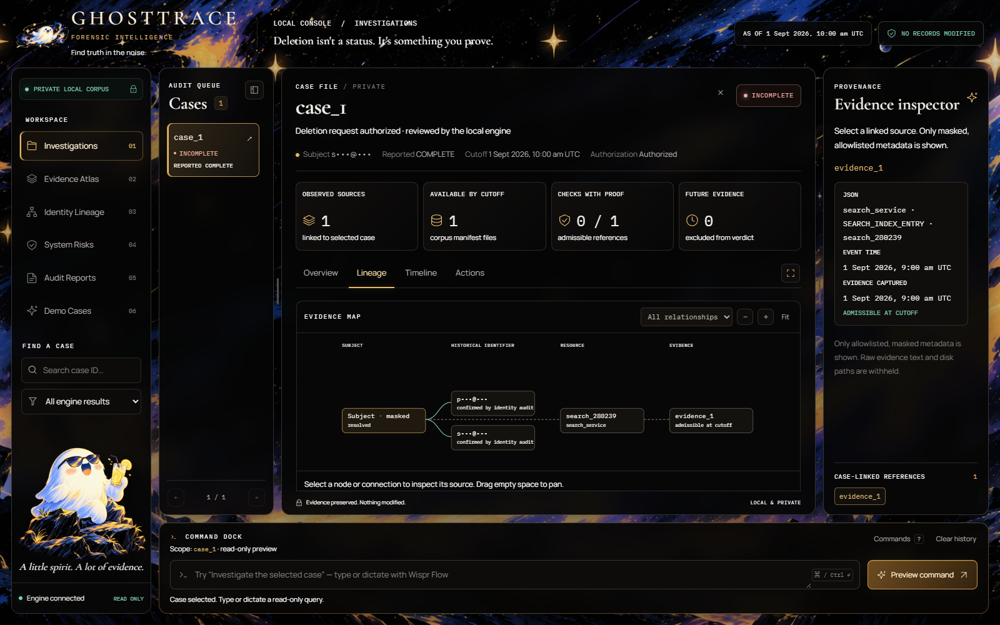

# A short GhostTrace walkthrough

[Project overview](../README.md) · [Setup](SETUP.md) · [Evidence](EVIDENCE.md)

## In one minute

GhostTrace asks whether a reported deletion is supported by evidence. The strongest product example is the difference between **reported COMPLETE** and **audited INCOMPLETE**, followed by a source that explains why.

The screenshot below is the actual local application on the existing `historical_alias`, variant `0`, test fixture. The request ID was renamed to `case_1` for the dashboard's numeric-ID contract. The fixture uses fictional `example.test` identifiers; no participant evidence is included.

1. **Compare the claim and result.** The workflow reports COMPLETE. The auditor finds a surviving search record and returns INCOMPLETE.
2. **Follow Lineage.** The historical identifier connects the subject to the resource. Click a linked source to see its system, resource and timestamps in the inspector.
3. **Check Actions.** Findings cite the source. Deletion is a recommendation, followed by a proposed absence check; neither has been executed.

[Screenshot provenance](media/README.md) explains exactly what was captured. The illustrated ghost artwork is interface decoration, not evidence.

## With the challenge dataset: case_104

After [starting the dashboard](SETUP.md#open-the-dashboard), search for `case_104`.

| Inspect | What to look for |
| --- | --- |
| Overview | Reported COMPLETE versus the auditor's INCOMPLETE result |
| Lineage | Attributable search and analytics resources, plus an active data flow |
| Evidence inspector | Case-linked reference, resource/system metadata and cutoff admission |
| Timeline | Event and capture clocks; later evidence must not change the as-of answer |
| Actions | Stop the active flow before dependent record treatment; analytics policy requires anonymization |
| Audit Reports | A sanitized Markdown report stating that no records were modified |

This example describes the participant-facing challenge workload. It is not evidence about a real company's systems, and it is separate from the synthetic screenshot above. A local strict check passing is not proof that every relevant copy has been found.

## What the recording demonstrates

The [Wispr Flow × GhostTrace recording](https://youtu.be/rw3gSNBh9HQ) shows voice-directed development with an AI coding assistant. It supports build-process provenance. It does not demonstrate a deployed service, a native Wispr integration or the planned Nebius/NVIDIA extension.

## Assess the result fairly

Read the [current evaluation report](../code/evaluation/evaluation_report.md) alongside the example. Public status agreement is 29/32, while exact ordered sequence agreement is 8/32. Those answer different questions. The 518-row output passed local structural checks; hidden-case accuracy remains unknown.
